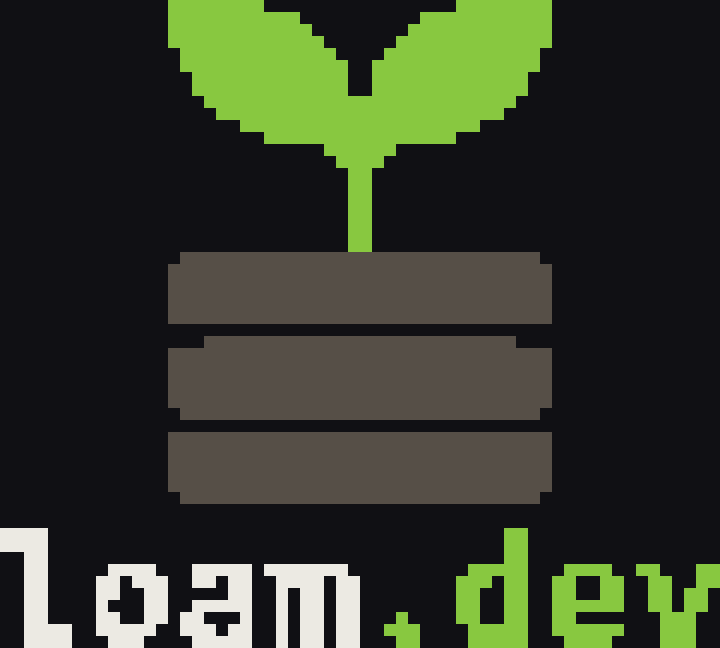

<p align="center">
  
</p>

<p align="center">
  <strong>Codebase intelligence &amp; anti-AI-slop for Dart &amp; Flutter.</strong>
</p>

<p align="center">
  Catch the <em>structural drift</em> and <em>AI-generated slop</em> that
  <code>dart analyze</code> never sees — behind a baseline/ratchet CI gate that
  never paints a grown codebase red on day one.
</p>

<p align="center">
  <a href="https://pub.dev/packages/loam"></a>
  <a href="https://github.com/silvio-l/loam/actions/workflows/qa.yml"></a>
  
  
  
</p>

<p align="center">
  <a href="https://getloam.dev"><strong>getloam.dev</strong></a>
  &nbsp;·&nbsp;
  <a href="https://github.com/silvio-l/loam">github.com/silvio-l/loam</a>
</p>

> **loam.dev** is the product; **`loam`** is the CLI command and the pub.dev
> package name. Built on the Dart `analyzer` package — semantically accurate,
> project-wide, offline by default.

---

## Why loam.dev?

AI coding agents generate Dart/Flutter faster than anyone can review. Two kinds
of problems slip straight past the built-in `dart analyze`:

1. **Structural drift** — dead code, duplication, circular dependencies,
   complexity hotspots, violated architecture boundaries.
2. **AI-slop** — empty `catch` blocks, narrative filler comments, ungrounded
   `// ignore:`, duplicated helpers, dead guard clauses, hallucinated abstractions.

JS/TS has mature tools for this. **Dart/Flutter has had nothing free and
slop-aware** — the closest is DCM, but its best rules sit behind a commercial
license and it has no LLM-backed slop detection. loam.dev closes that gap.

## What it catches

**Available now (0.1.16) — twenty live rules:** project-wide **unused public API**
(dead exports, classes, methods, getters/setters and fields), **circular
dependencies** between first-party libraries, **architecture
boundaries** (imports across a forbidden layer boundary configured in `loam.yaml`), **code duplicates** (AST-normalised
token hashing — exact and structurally identical copies; one Finding per cluster
with all locations), **complexity hotspots**
(cyclomatic/cognitive, aggregated into a `loam health` score; scans `lib/` and
`bin/` by default — configure with `source_dirs` in `loam.yaml`), **AI-slop**
(`slop-empty-catch` — empty and comment-only `catch` bodies;
`slop-unjustified-ignore` — `// ignore:` and `// ignore_for_file:` directives
without a written justification;
`slop-narrative-comment` — `//` comments that restate the declaration name, plus
banner/divider comments, empty category labels, emoji-only decoration,
end-of-block markers, and vague TODOs;
`slop-workflow-narration-comment` — sequential `Step 1:`/`First,`/`Next,`/
`Then,`/`Finally,` comments narrating a function body step-by-step;
`slop-placeholder-comment` — comments such as `// ... rest of code` or `// your
code here` standing in for code that is missing;
`slop-unimplemented-stub` — functions and methods in `lib/`/`bin/` whose whole
body is `throw UnimplementedError()`;
`slop-tautological-assertion` — `expect`/`expectLater` calls that compare a constant with a
constant or a value with itself, such as `expect(true, isTrue)`, and so cannot fail;
`slop-undisposed-resource` — fields a `State` (or a class with its own
`dispose()`) creates itself, such as a `TextEditingController` or a
`Timer.periodic`, that `dispose()` never releases;
`slop-assertion-free-test` — `test`/`testWidgets` bodies that never `expect`, `verify`
or `check` anything, not even through your own helper functions;
`slop-setstate-after-async-gap` — `setState` in a Flutter `State` after an `await`
or in a `Future.then` callback with no `mounted` check, which throws once the screen is closed;
`hardcoded-secrets` — API keys, passwords and tokens written into string
literals, offline and with the value never echoed), and **accessibility** (WCAG 1.1.1 — Flutter
images without a semantic label; WCAG 4.1.2 — icon buttons, gesture/ink-well
with pure icon child, and generic interactive widgets without an accessible name;
WCAG 3.3.2 — form fields without a label). All on the resolved Dart element model
— not regex — behind the baseline/ratchet gate.

Everything else is the **target surface**: each lands as one plugin behind a
single, stable `Rule` interface, so adding a feature never changes the pipeline
(🚧 = planned).

| Structural drift (deterministic, semantic) | AI-slop (deterministic **+** optional LLM) | Accessibility (WCAG, semantic) |
|---|---|---|
| ✅ Unused public exports, files, members | ✅ Ungrounded `// ignore:` (slop-unjustified-ignore) | ✅ Image without semantic label (a11y-image-label, WCAG 1.1.1) |
| ✅ Circular dependencies | ✅ Empty / comment-only `catch` blocks (slop-empty-catch) | ✅ Icon button without accessible name (a11y-icon-button-label, WCAG 4.1.2) |
| ✅ Code duplicates (AST-normalised) | ✅ Narrative filler comments (slop-narrative-comment) | ✅ Form field without label (a11y-form-field-label, WCAG 3.3.2) |
| ✅ Complexity hotspots + health score | ✅ Sequential workflow narration (slop-workflow-narration-comment) | ✅ Interactive widget without semantics (a11y-interactive-semantics, WCAG 4.1.2) |
| | ✅ Hardcoded secrets (hardcoded-secrets) | |
| | ✅ Tautological test assertions (slop-tautological-assertion) | |
| | ✅ setState after an async gap (slop-setstate-after-async-gap) | |
| ✅ Architecture-boundary violations (architecture-boundaries) | 🚧 Hallucinated / superfluous abstractions | |

## What makes it different

- **🌱 Semantic, not regex.** Structural rules use the resolved Dart element
  model and project-wide graphs — real whole-program resolution, not heuristics.
  *(live)*
- **🔒 Baseline / ratchet gate (the default).** Freeze today's accepted findings;
  from then on only **new** findings fail CI. Monotone improvement, no day-one red.
  *(live)*
- **📦 Dart-native.** Installed via `dart pub global activate loam`. SemVer;
  `ruleset@ver` is part of the baseline identity (`prompt@ver` joins it with the
  LLM layer). *(live)*
- **♻️ Reproducible, even with an LLM.** The LLM proposes `{score, label}` →
  cached by `sha(code)+prompt@ver` → fixed thresholds decide. Same code = cache
  hit = stable verdict = zero token cost. No flaky gate. *(🚧 planned)*
- **📄 Self-contained HTML report.** A single offline `.html` artifact: browse
  findings by rule, severity, or file, each with its remedy — no server, no hosting. `loam scan
  --format html` writes `loam-report.html` and opens it in your browser; use
  `--output <file>` to pick the path, `--no-open` to skip the browser (auto-open
  is suppressed for piped output and under CI). *(live since 0.1.3; redesigned in 0.1.16)*
- **🧭 Preventive recommendations for agents.** After a run with findings,
  loam.dev appends one curated, agent-addressed recommendation per fired rule
  class — how to avoid that class of finding going forward — and asks the
  agent to propose it to you for your persistent instructions (e.g.
  `CLAUDE.md`). Deterministic, no LLM call; structured as a `recommendations`
  array in `--format json`. loam.dev never writes to your instructions itself.
  *(live)*

## Quick start

> **0.1.16.** Twenty analysis rules are live — `unused-public-exports`,
> `circular-dependencies`, `architecture-boundaries`, `code-duplicates`, `complexity-hotspots`,
> `hardcoded-secrets`, `slop-empty-catch`, `slop-unjustified-ignore`,
> `slop-narrative-comment`, `slop-workflow-narration-comment`,
> `slop-placeholder-comment`, `slop-unimplemented-stub`, `slop-tautological-assertion`,
> `slop-undisposed-resource`, `slop-assertion-free-test`, `slop-setstate-after-async-gap`,
> `a11y-form-field-label`,
> `a11y-image-label`, `a11y-icon-button-label`,
> `a11y-interactive-semantics` — plus the `loam health` composite score.
> Commands marked *coming soon* are wired in `loam --help` but not yet
> implemented.

### Install

**Homebrew (Apple Silicon macOS & Linux — recommended).** No `PATH` setup, lands
on a directory that is already on your `PATH`:

```bash
brew install silvio-l/loam/loam
```

`brew upgrade loam` updates it. (Intel Macs: use the Dart pub path below.)

**Dart pub (all platforms).** The pub.dev package:

```bash
dart pub global activate loam
```

This installs into `$HOME/.pub-cache/bin`, which is **not** on your `PATH` by
default — Dart prints a reminder if it isn't. The `export` line it shows only
lasts for the current shell; make it permanent by adding it to your shell config
**once**:

<details>
<summary>Put <code>~/.pub-cache/bin</code> on your <code>PATH</code> permanently</summary>

```bash
# zsh (macOS default)
echo 'export PATH="$PATH:$HOME/.pub-cache/bin"' >> ~/.zshrc && source ~/.zshrc

# bash
echo 'export PATH="$PATH:$HOME/.pub-cache/bin"' >> ~/.bashrc && source ~/.bashrc
```
</details>

loam updates a pub install by itself (see **Updates** below); to update by
hand, re-run `dart pub global activate loam`.

<details>
<summary>Install the unreleased <code>dev</code> branch instead</summary>

```bash
dart pub global activate --source git https://github.com/silvio-l/loam.git \
    --git-path packages/loam_cli --git-ref dev
```
</details>

### Use

Available now (twenty live rules — unused exports, circular deps, architecture boundaries, code duplicates, complexity hotspots, slop, a11y):

```bash
loam scan                          # full audit: all active rules, whole repo
loam scan /path/to/project         # same, positional path to project root
loam baseline --write              # freeze the remaining, accepted state
loam gate                          # CI from now on — ratchet: only new findings fail
loam gate /path/to/project         # same, positional path to project root
```

Iterate locally — re-audit on every save and see what is new or resolved:

```bash
loam watch                         # full audit, then re-run after each change (Ctrl+C stops)
loam watch /path/to/project        # same, positional path to project root
```

Initialise configuration:

```bash
loam init                          # scaffold loam.yaml (incl. detected architecture layers)
loam init /path/to/project         # same, positional path to project root
```

Composite health score:

```bash
loam health                        # composite score (findings + complexity) & grade
loam health /path/to/project       # same, positional path to project root
```

Accessibility scan:

```bash
loam a11y                          # accessibility audit: WCAG-focused rules only
loam a11y /path/to/project         # same, positional path to project root
```

AI-slop scan:

```bash
loam slop                          # AI-slop audit: slop-focused rules only
loam slop /path/to/project         # same, positional path to project root
```

Only what you touched (`scan` and `gate`): the analysis stays project-wide, so
cross-file rules keep their full context, but the report and the gate narrow to
files that git lists as changed:

```bash
loam scan --changed                # working copy: staged, unstaged and untracked files
loam gate --staged                 # pre-commit: files in the git index
loam gate --since origin/main      # CI/PR: files changed since the merge base with a ref
```

`--staged`, `--since <ref>` and `--changed` are mutually exclusive. Outside a git
repository, or with an unknown ref, loam exits with 64. In ratchet mode the diff
against `baseline.json` stays project-wide and only its result is narrowed, so
unchanged files never show up as "fixed".

pre-commit recipe (`.git/hooks/pre-commit`, or a hook manager of your choice):

```bash
#!/bin/sh
exec dart pub global run loam gate --staged
```

In hooks and CI call `dart pub global run loam …` instead of bare `loam`: pub
puts its shim in `$HOME/.pub-cache/bin` on macOS/Linux but in
`%LOCALAPPDATA%\Pub\Cache\bin` on Windows, so a hook that assumes a `PATH`
entry fails there, while `dart` itself is always on the `PATH` of a Dart/Flutter
setup. If `dart` is missing, the hook's shell reports it as not found; install
the Dart or Flutter SDK, then `dart pub global activate loam`.

All eight commands (`scan`, `watch`, `gate`, `health`, `init`, `baseline`, `a11y`, `slop`) accept an
optional positional `[path]` as the project root. The explicit `-p`/`--project-root`
option overrides the positional path when both are given.

Coming soon (wired in `loam --help`, not yet implemented):

```bash
loam fix --safe                    # apply mechanical fixes
```

**Onboarding an existing repo** (turn an established codebase green, then keep it
green): `scan` → clean up → `baseline --write` → `gate` in CI. A later cleanup
round just repeats it. Fixed findings leave stale entries in `baseline.json`: `gate`
names them, `baseline --prune` removes them, `gate --strict-baseline` fails on them.
Greenfield? `loam gate --absolute` needs no baseline.

**Rule profiles.** `loam gate` blocks only on the `core` profile by default:
rules with a near-zero false-positive rate (`circular-dependencies`,
`architecture-boundaries`, `unused-public-exports`, `slop-empty-catch`, `slop-tautological-assertion`, `slop-unjustified-ignore`,
`hardcoded-secrets`). The heuristic and threshold-based rules show up as a hint;
`loam gate --profile strict` (or `profile: strict` in `loam.yaml`) lets them
block too. The baseline is the same for both; a gate that was red only
because of strict rules turns green after upgrading, so set `profile: strict` to
keep the old behaviour. See [`docs/developer-guide.md`](./docs/developer-guide.md).

**Updates.** loam.dev keeps itself current without slowing a run: at most once
a day it checks pub.dev in a detached background process, and the next run
reports the result on stderr — never on stdout, never touching the exit code.
How the update lands depends on how loam was installed:

| Install | What happens |
|---|---|
| `dart pub global activate loam` | Updated automatically (`dart pub global activate loam <version>`; pub verifies the archive checksum). |
| Standalone binary from a GitHub release | Updated automatically: the archive is only used if it matches the release's `.sha256`, then it replaces the binary. |
| Homebrew | Notice only — run `brew upgrade loam` (loam never drives Homebrew for you). |
| Source checkout, git/path pub install, locally compiled binary | Notice only. |

After an automatic update the next run says so once and lists any rules the
update added or removed, so new findings are not mistaken for regressions; the
gate repeats that hint when it turns red on a changed ruleset. `loam --version`
prints the running version, the install channel and the path.

**Pin the version** for reproducible gates with `required_version` in
`loam.yaml` (a pub constraint such as `">=0.1.15 <0.2.0"` or an exact
`"0.1.15"`): a pinned project is never updated, other commands warn when the
running version does not match, and `loam gate` stops with exit code 78.

Nothing is checked or installed in CI (common CI variables such as `CI`,
`GITHUB_ACTIONS`, `GITLAB_CI`), with `LOAM_OFFLINE` set, or when turned off:
`--no-update-check`, `LOAM_NO_UPDATE_CHECK` or `update_check: false` switch off
check and update; `LOAM_NO_AUTO_UPDATE` or `auto_update: false` keep the notice
but never install.

## Built for the terminal

<p align="center">
  
</p>

Machine-readable output for CI and agents, a human-readable report for you:

```
--format human        # default, readable terminal output      (available)
--format sarif        # CI / code-scanning                      (available)
--format json         # agent / tooling integration             (available)
--format markdown     # PR / docs embedding                     (available)
--format html         # interactive, self-contained report      (available)
--format agent        # compact, capped list for agents/chat    (available)
--max-findings <n>    # agent only: list at most n findings (default 20, 0 = all)

# human/sarif/json/markdown/agent stream to stdout; html writes a file and opens it.
# Except for human and html, stdout carries only the report; summaries and hints go to stderr.
--output <file>       # write the report to <file> (html: overrides loam-report.html)
--no-open             # html only: don't open the browser (auto-off when piped/CI)
--no-progress         # suppress the live progress bar (auto-off when piped/CI)
--timing              # print wall-clock time per phase and per rule to stderr
--no-cache            # don't keep the analyzer store in .dart_tool/loam/ (same results)
--timeout <duration>  # abort a hanging run (default 10m; 90s, 10m, 1h; 0 = off); exit 124

# scan, gate, baseline, slop, a11y and health all show the same live progress
# bar in an interactive terminal; --no-progress / LOAM_NO_PROGRESS silence it
# on any of them, and it is never emitted in structured formats.
```

## Status & roadmap

**0.1.16** — twenty rules live end to end (`unused-public-exports`,
`circular-dependencies`, `architecture-boundaries`, `code-duplicates`, `complexity-hotspots`,
`hardcoded-secrets`, `slop-empty-catch`, `slop-unjustified-ignore`,
`slop-narrative-comment`, `slop-workflow-narration-comment`,
`slop-placeholder-comment`, `slop-unimplemented-stub`, `slop-tautological-assertion`,
`slop-undisposed-resource`, `slop-assertion-free-test`, `slop-setstate-after-async-gap`,
`a11y-form-field-label`, `a11y-image-label`,
`a11y-icon-button-label`, `a11y-interactive-semantics`) plus the `loam health`
composite score; the remaining capabilities land as individual rules behind
the same `Rule` interface.

For a detailed walkthrough of concepts, CLI commands, output formats, and codegen
handling, see the **[Developer & Tool Guide](./docs/developer-guide.md)**.

## Repo layout

This is a monorepo — everything that makes up loam.dev:

| Path | What |
|---|---|
| [`packages/loam_cli/`](./packages/loam_cli/) | The Dart CLI (pub.dev package `loam`). The actual tool. |
| [`web/`](./web/) | Promo / docs website (static, multipage, EN/DE, free-tier). See its [README](./web/README.md). |
| [`skill/`](./skill/) | Claude skill/plugin that drives `loam` for agents. Scaffold. |
| [`assets/brand/`](./assets/brand/) | Logo, colors, terminal banner. See its [README](./assets/brand/README.md). |
| [`docs/`](./docs/) | Developer & tool guide. |

### Website routes (`web/`)

The site is multilingual (EN default at root, DE under `/de/`) with 10 pages:

| EN route | DE route | Content |
|---|---|---|
| `/` | `/de/` | Home — hero with install, then problem → what it finds → workflow → proof → FAQ → get started |
| `/how-it-works` | `/de/how-it-works` | Pipeline walkthrough |
| `/rules` | `/de/rules` | Rule catalogue (live + planned) |
| `/privacy` | `/de/privacy` | Privacy policy |
| `/developer-guide` | `/de/developer-guide` | Developer & Tool Guide (rendered on-site from `docs/developer-guide.md`) |

All pages share a single `Layout.astro` (brand tokens, hreflang alternates, footer).
Font: self-hosted `@fontsource/spline-sans-mono` (no Google CDN).
Sitemap: `@astrojs/sitemap` (documented exception — deterministic static XML, no runtime service).

## Develop

The Dart package lives in `packages/loam_cli/`:

```bash
cd packages/loam_cli
dart pub get
find test/fixtures -name pubspec.yaml -execdir dart pub get \;   # fixture packages (optional: the tests resolve them themselves)
dart format --output=none --set-exit-if-changed bin lib test
dart analyze --fatal-infos --fatal-warnings
dart test
dart run bin/loam.dart scan
```

loam.dev's first test target is **its own codebase** — the tool that finds slop
and drift must carry none itself.

## Contributing

Bug reports and feature ideas are welcome via
[GitHub Issues](https://github.com/silvio-l/loam/issues); open-ended
questions and ideas fit better in
[Discussions](https://github.com/silvio-l/loam/discussions). See
[CONTRIBUTING.md](./CONTRIBUTING.md) for the local gate commands and commit
conventions, and [SECURITY.md](./SECURITY.md) to report vulnerabilities
privately. Participation is governed by the
[Code of Conduct](./CODE_OF_CONDUCT.md).

## License

MIT © 2026 Silvio Lindstedt
